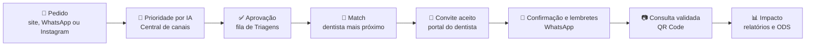
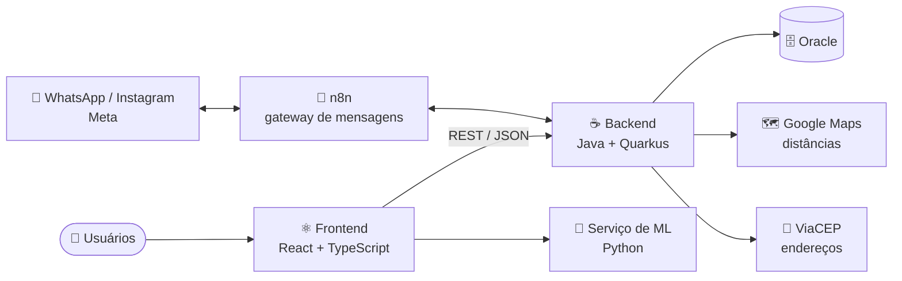

<div align="center">

# 🦷 StartUpados() — Plataforma Turma do Bem

**Sistema full-stack para digitalização e gestão da ONG [Turma do Bem](https://www.turmadobem.org.br/)**: site institucional, solicitação de atendimento online, portais do paciente e do dentista voluntário, dashboard administrativo com dados reais, priorização por _Machine Learning_, match de dentistas por distância, mutirões, mensageria por WhatsApp e Instagram e relatórios de impacto.

[](https://react.dev/)
[](https://www.typescriptlang.org/)
[](https://vitejs.dev/)
[](https://tailwindcss.com/)
[](https://openjdk.org/)
[](https://quarkus.io/)
[](https://www.oracle.com/database/)
[](https://www.python.org/)

### 🔗 Acesso ao Projeto

[**🌐 Aplicação ao vivo**](https://www.startupados.com.br/)

</div>

🇺🇸 _[English version](README.en.md)_

---

## 📑 Sumário

- [Sobre o Projeto](#-sobre-o-projeto)
- [Jornada do Paciente](#-jornada-do-paciente)
- [Arquitetura](#-arquitetura)
- [Stack Tecnológica](#-stack-tecnológica)
- [Funcionalidades](#-funcionalidades)
- [Machine Learning](#-machine-learning--priorização-de-atendimentos)
- [Match de Dentistas](#-match-de-dentistas)
- [Integrações](#-integrações)
- [Segurança & Privacidade](#-segurança--privacidade)
- [Roadmap](#-roadmap)
- [Equipe](#-equipe)
- [Licença](#-licença)

---

## 🎯 Sobre o Projeto

A **Turma do Bem** é uma ONG que oferece tratamento odontológico gratuito, por meio de dentistas voluntários, para dois públicos em situação de vulnerabilidade:

- **Dentista do Bem**: jovens de 11 a 17 anos de famílias de baixa renda
- **Apolônias do Bem**: mulheres vítimas de violência com a dentição afetada

A plataforma **StartUpados()** digitaliza o processo da ONG de ponta a ponta. O pedido chega pelo site, pelo WhatsApp ou pelo Instagram. A IA sugere a prioridade, a equipe aprova e o sistema indica o dentista voluntário mais próximo. O dentista aceita pelo portal, a paciente recebe confirmação e lembretes, e a consulta é validada por QR Code. No fim, cada atendimento concluído vira número nos relatórios de impacto para doadores e parceiros.

> **Backend-first:** toda regra de negócio fica no backend Java/Quarkus e o **Oracle** é a fonte única da verdade. O frontend guarda apenas um cache local para abrir rápido e mescla com os dados do banco a cada carga.

---

## 🧭 Jornada do Paciente



---

## 🏛 Arquitetura



| Princípio | Como aparece no projeto |
|---|---|
| **Separação de responsabilidades** | Frontend cuida da experiência; backend, da regra de negócio; banco, da persistência |
| **Fonte única da verdade** | Oracle, acessado somente pelo backend |
| **Gateway sem estado** | O n8n só entrega mensagens; quem decide o conteúdo e grava no banco é o backend |
| **Falha visível** | Quando o servidor recusa uma operação, a tela mostra o motivo, em vez de fingir que gravou |

---

## 🛠 Stack Tecnológica

### Frontend

| Tecnologia | Uso |
|---|---|
| React 19 + TypeScript 5.9 | Interface e tipagem |
| Vite 8 | Build e servidor de desenvolvimento |
| Tailwind CSS 3.4 | Estilização e responsividade |
| React Router 7 | Roteamento e rotas protegidas por perfil |
| React Hook Form | Formulários e validação |
| Recharts | Gráficos do dashboard |
| qrcode.react + jsQR | Geração e **leitura pela câmera** de QR Code |
| jsPDF | Relatórios em PDF |
| Sonner | Notificações (toasts) |
| Lucide | Ícones |

### Backend

| Tecnologia | Uso |
|---|---|
| Java 21 + Quarkus | API REST |
| Jakarta REST (JAX-RS) | Recursos e rotas |
| JDBC + Oracle Database | Persistência |
| JWT | Autenticação por perfil |

### Machine Learning

| Tecnologia | Uso |
|---|---|
| Python + FastAPI | API de previsão |
| LightGBM / scikit-learn | Modelo de classificação |
| Pandas, Seaborn, Matplotlib | Dados e análise exploratória |

### Integrações

| Serviço | Uso |
|---|---|
| WhatsApp Cloud API (Meta) | Confirmação, lembretes, botões de resposta e mensagens |
| Instagram (Meta) | DMs recebidas e respondidas na Central de canais |
| n8n | Orquestração dos fluxos de mensagem |
| Google Maps (Distance Matrix) | Distância real de carro entre paciente e consultório |
| ViaCEP | Endereço completo a partir do CEP |
| VLibras | Acessibilidade em Libras |

---

## ✨ Funcionalidades

### 🏠 Site Institucional
- Home com carrossel e seções sobre os programas
- Páginas: Nossos Serviços, Sobre Nós, Integrantes, FAQ e Fale Conosco
- Políticas de privacidade da StartUpados e da Turma do Bem
- Acessibilidade com **VLibras** e layout **responsivo** (celular, tablet e desktop)

### 📝 Solicitação de Atendimento
- Escolha entre **Dentista do Bem** e **Apolônias do Bem**
- Formulário em **3 etapas** para jovens (adolescente, responsável, atendimento) e em **2 etapas** para mulheres
- Máscaras de CPF, CEP e telefone, e validação de idade por programa
- **Protocolo** gerado pelo sistema (`TDB-AAAA-NNNN` / `APO-AAAA-NNNN`), **senha de acesso** e **QR Code** com botão **Baixar QR Code**
- Autorização opcional para receber lembretes por WhatsApp

### 💬 Central de Canais (admin)
- Solicitações do site e DMs do **Instagram** em um só lugar
- Ficha do formulário organizada: necessidade, observações, responsável, renda e origem
- **Classificação de prioridade por IA** (Alta, Média, Baixa) com confiança e botão **Entenda mais**, que explica os fatores da decisão
- Tempo real na fila desde o cadastro
- Aprovar (envia para Triagens), recusar com motivo, responder, promover, encaminhar, arquivar e reabrir
- KPIs: novas hoje, alta prioridade sem resposta, tempo médio de resposta, confiança média do modelo

### 🧑‍⚕️ Triagens
- Fila de pacientes aprovados, com prioridade, idade, programa e tempo de espera
- **Sugestão de dentistas** ordenada por proximidade real, especialidade e avaliação
- Convite ao dentista e acompanhamento: aguardando, convite enviado, aceito ou recusado com motivo
- Criação manual de triagem (escolas, mutirões, atendimento presencial)

### 📅 Atendimentos
- Agenda com o ciclo completo: agendado, confirmado, em andamento, concluído, cancelado e reagendado
- Detalhes com **local do atendimento** (endereço do consultório)
- **Contatar paciente** por WhatsApp Web ou e-mail
- Tratamentos em várias sessões ("sessão 2 de 3")

### 📷 Validação por QR Code
- **Leitura pela câmera** do celular ou do notebook, ou digitação do protocolo
- Ficha do paciente com linha do tempo das sessões
- **Confirmar atendimento** registra a sessão como concluída; só o dentista responsável pela consulta consegue confirmar

### 🦷 Portal do Dentista
- Convites de pacientes com distância e caso, **Aceitar** escolhendo data e horário, ou **Recusar** com motivo
- Convites para **mutirões** (aceitar ou recusar)
- Próximos atendimentos e **histórico de consultas** (as 5 mais recentes e **Ver mais**)
- Endereço completo do consultório e **Editar endereço** com preenchimento pelo CEP
- Atalho para validar paciente por QR Code

### 🔐 Portal do Paciente
- Protocolo(s) no topo, com botão de copiar
- **QR Code** para mostrar ao dentista, com download
- Próxima consulta com dentista, data, horário e endereço do consultório
- Histórico e progresso do tratamento
- Encerramento automático da sessão por inatividade, com aviso prévio

### 🤝 Voluntários
- Cadastro público de dentista em 3 etapas (pessoais, profissionais, atuação)
- Aprovações pendentes com o **tempo real de espera** desde o cadastro
- Aprovar, rejeitar, suspender e reativar
- Perfil do dentista com especialidade, atendimentos e próximos compromissos
- Contato por WhatsApp e e-mail

### 📣 Mutirões
- Cadastro de mutirões (triagem em escola ou atendimento em comunidade), com data, horário, local, programa, especialidades e meta
- **Convocação de dentistas**, que ficam como *Aguardando resposta* até aceitarem no portal (*Confirmado* ou *Recusou*)
- Mutirão com data passada vira *realizado* e entra nos indicadores

### 📊 Visão Geral
- KPIs com dados reais: consultas concluídas, agendadas, fila de triagem, voluntários
- Gráfico dos últimos 6 meses e distribuição por programa
- **Meta anual** de atendimentos ajustável no menu lateral
- Uma regra única em todo o sistema: atendimento é **consulta concluída**

### 📄 Relatórios e Impacto
- Página com **dados reais** por período: mês, trimestre, ano ou intervalo personalizado
- Sorrisos transformados, pacientes atendidos por programa e especialidade, municípios e regiões alcançados, comparecimento, mutirões e meta anual
- Contribuição para os **ODS 3, 4, 5 e 10**
- **PDF por público** (doador, parceiro, ODS, interno) e **CSV**, ambos **sem dados pessoais** de pacientes
- Histórico dos relatórios gerados, com download do mesmo PDF

### ⚙️ Configurações
- Equipe administrativa com perfis e status
- Status das integrações (ML, WhatsApp, Instagram, Google, banco de dados)
- Dados da organização

### 💰 Financeiro *(protótipo)*
- Doações, despesas, parceiros e indicadores. Ainda usa dados de exemplo; a integração com o banco está no roadmap.

### 🌙 Recursos gerais do dashboard
- Modo escuro restrito ao dashboard
- Layout responsivo em todas as telas
- Mensagens de erro claras, com o motivo vindo do servidor

---

## 🤖 Machine Learning — Priorização de Atendimentos

Modelo que classifica cada solicitação em **ALTA**, **MÉDIA** ou **BAIXA** prioridade, para a ONG atender primeiro quem mais precisa. Ele **sugere** a prioridade; quem decide é a equipe, que vê os motivos e pode reclassificar.

| Item | Detalhe |
|---|---|
| Modelo | LightGBM |
| Acurácia | 94,7% |
| F1 macro | 0,944 (teste 80/20) |
| Variáveis | programa, sexo, idade, tempo de espera, tipo de violência, vulnerabilidade, dano dentário, tipo de pedido, tipo de tratamento |
| Servido como | API REST consumida pela Central de canais |

### Dataset

| Prioridade | Quantidade | % |
|---|---|---|
| BAIXA | 1.151 | 44% |
| MÉDIA | 937 | 35% |
| ALTA | 550 | 21% |
| **Total** | **2.638** | |

### Regras de negócio que orientam o modelo

**Apolônias do Bem (mulheres):**
- `ALTA`: dano grave + violência grave
- `ALTA`: dano grave + idade ≥ 50
- `ALTA`: dano moderado + violência grave + idade ≥ 45

**Dentista do Bem (jovens 11–17):**
- `ALTA`: vulnerabilidade alta + tratamento de canal ou extração
- `ALTA`: vulnerabilidade alta + restauração + espera > 20 dias

---

## 📍 Match de Dentistas

Para cada paciente na fila, o sistema ordena os voluntários ativos por uma pontuação composta:

| Critério | Peso |
|---|---|
| **Proximidade**: distância real de carro entre paciente e consultório | 60% |
| **Especialidade** compatível com a necessidade | 30% |
| **Avaliação** do dentista | 10% |

Os endereços são completados automaticamente a partir do CEP.

---

## 🔌 Integrações

### WhatsApp
O backend decide o conteúdo e o n8n apenas entrega a mensagem pela API oficial da Meta. Só recebe mensagem quem autorizou no cadastro.

| Fluxo | O que faz | Status |
|---|---|---|
| Recebimento | Mensagens de pacientes entram no sistema, sem duplicidade | ✅ |
| Confirmação | Enviada assim que o dentista aceita o convite | ✅ |
| Lembretes | Na véspera, no dia e 1 hora antes da consulta | ✅ |
| Botões de resposta | **Confirmar** ou **Reagendar** mudam o status do atendimento | ✅ |
| Disparo em massa | Comunicados para pacientes autorizados | ✅ |

### Instagram
DMs do perfil da ONG aparecem na aba **Instagram** da Central de canais e podem ser respondidas por lá.

### Google Maps e ViaCEP
Distâncias reais para o match de dentistas e endereços completos a partir do CEP, no cadastro e na edição do consultório.

---


## 🔒 Segurança & Privacidade

- **Nenhuma credencial no repositório**: chaves e segredos ficam em variáveis de ambiente fora do controle de versão
- **Autenticação por perfil** (administração, dentista e paciente), com o **controle de acesso feito no servidor**: cada perfil só vê e altera o que é seu
- **Dados mínimos por tela**: o dentista vê apenas os pacientes dele, e só ele valida a consulta
- **Relatórios, PDFs e CSVs sem dados pessoais** de pacientes
- **QR Code sem senha**: a foto do comprovante não dá acesso ao portal
- **WhatsApp apenas com autorização** (opt-in) da paciente ou do responsável
- **Sessão encerrada por inatividade**, com aviso antes
- **Validação de entrada** de CPF, CEP, idade e formatos antes de gravar
- Políticas de privacidade próprias, com a StartUpados como controladora dos dados da plataforma

> ⚠️ Credenciais de demonstração estão disponíveis **sob solicitação** e não são versionadas.

---

## 💻 Como Rodar Localmente

**Pré-requisitos:** Node.js 18 ou mais novo e npm.

```bash
git clone <url-do-repositório>
cd Front_TdB
npm install
npm run dev
```

As variáveis de ambiente (endereços da API e dos serviços) são fornecidas pela equipe e ficam em um arquivo `.env` que **não é versionado**.

| Comando | O que faz |
|---|---|
| `npm run dev` | Servidor de desenvolvimento |
| `npx tsc -b` | Checagem de tipos |
| `npm run lint` | Lint |
| `npm run build` | Checagem de tipos + build de produção |

> A câmera do leitor de QR Code só funciona em `localhost` ou em HTTPS.

---

## 🔜 Roadmap

- [x] Backend Java + Quarkus com Oracle
- [x] Frontend integrado ao backend via REST
- [x] Autenticação por perfil com JWT
- [x] Ciclo completo de solicitações, triagens e atendimentos
- [x] Modelo de ML servido como API e integrado à Central
- [x] Match de dentistas por distância real
- [x] API WhatsApp: recebimento, confirmação, lembretes, botões e disparo
- [x] API Instagram na Central de canais, recebimento de mensagens e respostas na DM
- [x] Validação por QR Code com câmera
- [x] Mutirões com convocação e aceite do dentista e de pacientes/beneficiários
- [x] Relatórios de impacto em PDF e CSV com dados reais
- [x] Financeiro integrado ao banco
- [x] Histórico de relatórios salvo no servidor
- [x] Sistema em Produção, no ar e funcionando (startupados.com.br)

---

## 👥 Equipe

Desenvolvido pelo grupo **StartUpados()**, FIAP 2026.

| Integrante | Atuação | Contato |
|---|---|---|
| **Pedro Henrique Falchi** | Front-end, integrações e Machine Learning | [LinkedIn](https://www.linkedin.com/in/pedro-henrique-falchi-4ab4b937b) |
| **Matheus Guimarães** | Backend e banco de dados | [LinkedIn](https://www.linkedin.com/in/matheus-guimar%C3%A3es-rosa-04522435b) |

📧 **Contato:** startupados@gmail.com

---

## 📄 Licença

Este projeto está licenciado sob a **Licença MIT**. Consulte o arquivo [`LICENSE`](LICENSE).

---

<div align="center">

**Desenvolvido por StartUpados() para a Turma do Bem**

_Transformando sorrisos, transformando vidas._ 🦷✨

</div>
